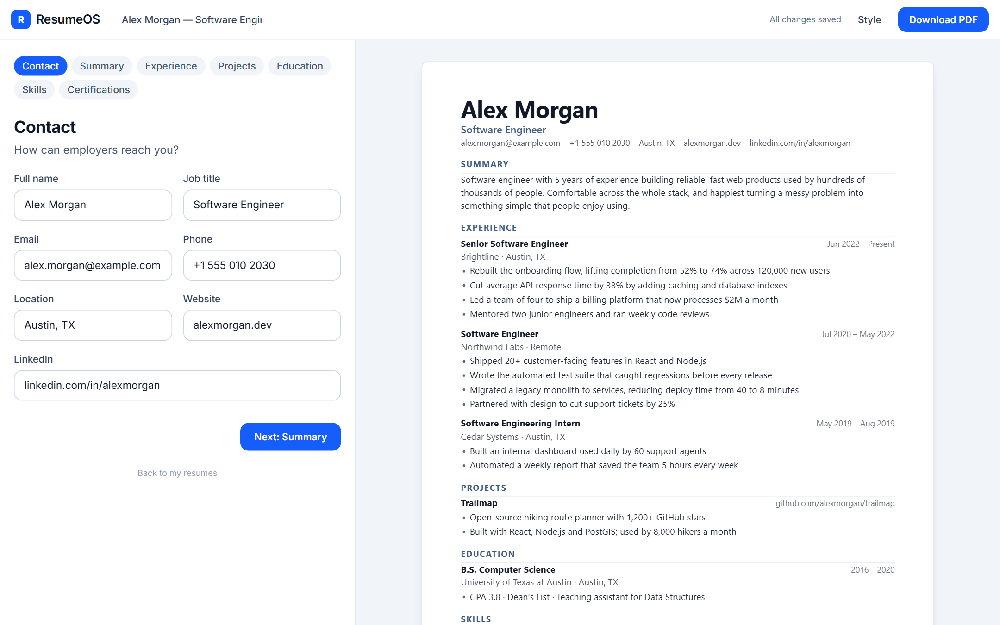
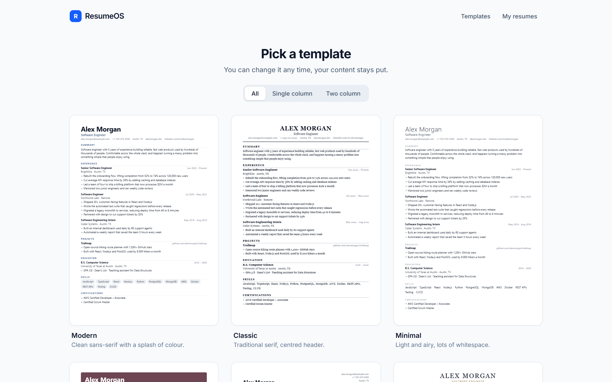
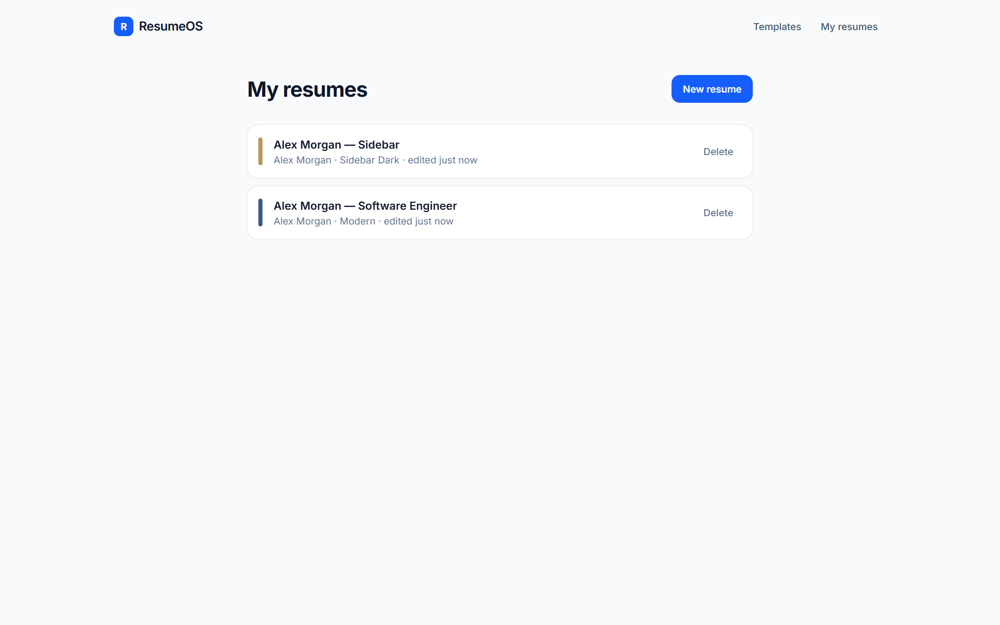

<h1 align="center">ResumeOS</h1>

<p align="center">
  A simple resume builder. Pick a template, answer a few short questions, and download a clean PDF.<br />
  No sign-up needed.
</p>

<p align="center">
  
</p>

## Features

- **14 templates** — 11 single-column layouts (Modern, Classic, Minimal, Bold, Compact, Elegant, Executive, Timeline, Split, Tech, Academic) and 3 sidebar layouts. Every template has an adjustable accent colour.
- **Guided editor** — one short step at a time: Contact, Summary, Experience, Projects, Education, Skills, Certifications.
- **Live preview** — the page next to the form is the resume itself, and it updates as you type.
- **PDF download** — the PDF is rendered from the exact HTML you're previewing, so what you see is what you get.
- **Autosave** — changes are saved as you go. You can keep up to 25 resumes.
- **No account** — your browser gets a random guest id on first visit (see [Limitations](#limitations)).

| Templates | My resumes |
|---|---|
|  |  |

## Tech stack

| | |
|---|---|
| Frontend | React 19, Vite, React Router, Tailwind CSS 4 |
| Backend | Node.js 20+, Express 5, TypeScript (run with `tsx`) |
| Database | MongoDB via Mongoose |
| Validation | Zod |
| PDF | Puppeteer (headless Chromium) |

## Getting started

You need Node.js 20 or newer. You do **not** need to install MongoDB: with no `MONGODB_URI` set, the server starts an embedded dev database that keeps its files in `server/.data`.

```bash
git clone https://github.com/Blunthead/resumeos.git
cd resumeos

# Backend — http://localhost:5000
cd server
npm install        # also downloads Chromium for PDF export
cp .env.example .env
npm run dev

# Frontend — http://localhost:5173 (in a second terminal)
cd frontend
npm install
cp .env.example .env
npm run dev
```

The first backend start downloads a MongoDB binary for the embedded database, so it can take a minute.

### Configuration

**`server/.env`**

| Variable | Default | Notes |
|---|---|---|
| `PORT` | `5000` | |
| `CLIENT_URL` | `http://localhost:5173` | Allowed CORS origin. Set it to the real frontend URL when deployed. |
| `MONGODB_URI` | _(empty)_ | Empty means the embedded dev database. **Required when `NODE_ENV=production`.** |

**`frontend/.env`**

| Variable | Default | Notes |
|---|---|---|
| `VITE_API_URL` | `http://localhost:5000` | Set before `npm run build`, since Vite bakes it into the bundle. |

### Scripts

| Where | Command | What it does |
|---|---|---|
| `server/` | `npm run dev` | API with auto-reload |
| `server/` | `npm start` | API, no reload |
| `server/` | `npm test` | Unit tests |
| `server/` | `npm run typecheck` | TypeScript check |
| `frontend/` | `npm run dev` | Vite dev server |
| `frontend/` | `npm run build` | Production build into `dist/` |
| `frontend/` | `npm run lint` | Oxlint |

## API

Every route needs an `x-guest-id` header. Anything else gets a `401`.

| Method | Route | |
|---|---|---|
| `GET` | `/api/resumes` | List your resumes (summary fields only) |
| `POST` | `/api/resumes` | Create a resume (max 25) |
| `GET` | `/api/resumes/:id` | Fetch one |
| `PUT` | `/api/resumes/:id` | Update title, template, accent or content |
| `DELETE` | `/api/resumes/:id` | Delete |
| `POST` | `/api/pdf` | Render `{ html, filename }` to a PDF (15 requests a minute) |

Every query is scoped to the caller's guest id, and another guest's resume answers `404`, not `403`, so ids can't be probed. Request bodies are validated with Zod, and every string and list has a length cap.

## How PDF export stays safe

The client sends the HTML it is previewing, so the PDF route amounts to "render caller-supplied HTML in a browser". That is only safe because the page is locked down: JavaScript is switched off and every network or file request is aborted, so injected markup can neither run code nor fetch anything. The input is size-capped, the filename is stripped to `[A-Za-z0-9 _-]`, and the route is rate-limited per guest. See [`server/src/routes/pdf.ts`](server/src/routes/pdf.ts).

## Project layout

```
server/
  src/
    index.ts            Express app and startup
    routes/             resumes.ts (CRUD), pdf.ts (export)
    middleware/         guest.ts (owner id), rateLimit.ts
    models/             Resume (Mongoose)
    lib/                db.ts, resumeSchema.ts (the one source of validation)
  tests/                node:test unit tests
frontend/
  src/
    pages/              Landing, Templates, Dashboard, Editor
    components/         ResumeDocument (the resume itself), PaperPreview, editor steps
    lib/                api.js, resume.js (template list, sample data)
```

## Limitations

- **Guest ids are not authentication.** Anyone who learns your id can read your resumes, and clearing your browser's storage loses access to them. The server isolates guests from each other, but it is a stand-in until real accounts exist, and swapping one in changes a single line in `middleware/guest.ts`.
- **The three sidebar templates use two columns.** Some applicant tracking systems read multi-column layouts out of order. If that matters for a job, use one of the single-column templates.
- **The rate limiter is in memory**, so it is per server instance.

## Contributing

Issues and pull requests are welcome. Please run `npm test` and `npm run typecheck` in `server/`, and `npm run lint` and `npm run build` in `frontend/`, before opening a PR. CI runs the same checks.

## License

[MIT](LICENSE) © Bilal Rakhangi
