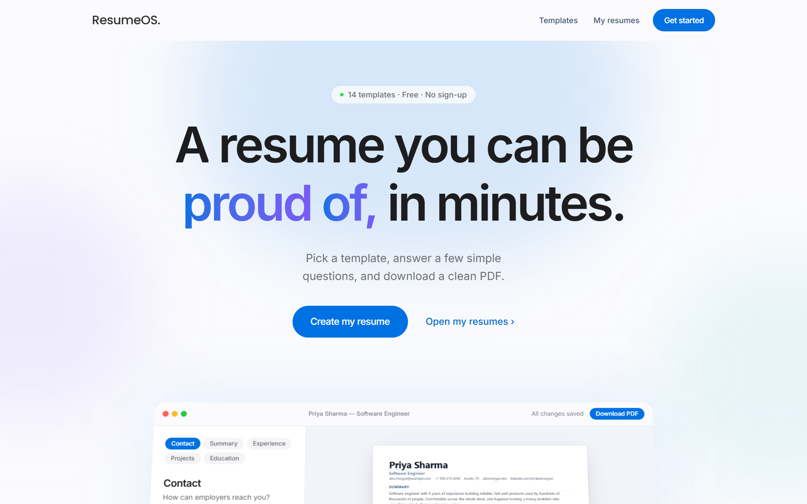

<h1 align="center">
  <picture>
    <source media="(prefers-color-scheme: dark)" srcset="docs/logo-dark.svg" />
    
  </picture>
</h1>

<p align="center">
  A simple resume builder. Pick a template, answer a few short questions, and download a clean PDF.<br />
  No sign-up needed.
</p>

<p align="center">
  <a href="https://resumeos-eta.vercel.app"><b>Try it live &rarr;</b></a>
</p>

<p align="center">
  <a href="https://resumeos-eta.vercel.app"></a>
  <a href="https://github.com/Blunthead/resumeos/actions/workflows/ci.yml"></a>
  <a href="LICENSE"></a>
  
</p>

<p align="center">
  
</p>

<p align="center">
  
</p>

## Features

- **14 templates** — 11 single-column layouts (Modern, Classic, Minimal, Bold, Compact, Elegant, Executive, Timeline, Split, Tech, Academic) and 3 sidebar layouts. They share one type scale and spacing system, so they feel like one product.
- **Guided editor** — Contact, Summary, Experience, Projects, Education, Skills, Certifications and Languages, one short step at a time.
- **Click to edit** — click any part of the resume preview and the form jumps to that section and focuses its first field.
- **Your own sections** — add Volunteer Work, Awards, Publications or anything else. Rename, duplicate, delete and reorder them like the built-in ones; they print in the PDF too.
- **Rearrange everything** — drag sections and entries into a new order, or use the arrow buttons (which also work by keyboard and on touch screens).
- **Text formatting** — bold, italic, underline, bulleted and numbered lists, with the usual shortcuts (Ctrl+B / I / U). Formatting is stored as plain markers, so it stays safe and ATS-friendly.
- **Style** — pick a template and colour, and set text size and spacing for the whole document.
- **Undo and redo** — Ctrl+Z / Ctrl+Shift+Z; typing is grouped into phrases, not letters.
- **Live preview and PDF** — the PDF is printed from the same HTML as the preview, with the same fonts embedded, so they match.
- **Autosave** — changes are saved as you go, including if you close the tab mid-edit, and retried automatically if the connection drops. You can keep up to 25 resumes.
- **No account** — your browser gets a random guest id on first visit (see [Limitations](#limitations)).

| Templates | My resumes |
|---|---|
|  |  |

## Tech stack

| | |
|---|---|
| Frontend | React 19, Vite, React Router, Tailwind CSS 4 |
| Backend | Node.js 20+, Express 5, TypeScript (run with `tsx`) |
| Database | MongoDB via Mongoose |
| Validation | Zod |
| PDF | Puppeteer (headless Chromium) |

## Getting started

You need Node.js 20 or newer. You do **not** need to install MongoDB: with no `MONGODB_URI` set, the server starts an embedded dev database that keeps its files in `server/.data`.

```bash
git clone https://github.com/Blunthead/resumeos.git
cd resumeos

# Backend — http://localhost:5000
cd server
npm install        # also downloads Chromium for PDF export
cp .env.example .env
npm run dev

# Frontend — http://localhost:5173 (in a second terminal)
cd frontend
npm install
cp .env.example .env
npm run dev
```

The first backend start downloads a MongoDB binary for the embedded database, so it can take a minute.

### Configuration

**`server/.env`**

| Variable | Default | Notes |
|---|---|---|
| `PORT` | `5000` | |
| `CLIENT_URL` | `http://localhost:5173` | Allowed CORS origin. Set it to the real frontend URL when deployed. |
| `MONGODB_URI` | _(empty)_ | Empty means the embedded dev database. **Required when `NODE_ENV=production`.** |

**`frontend/.env`**

| Variable | Default | Notes |
|---|---|---|
| `VITE_API_URL` | `http://localhost:5000` | Set before `npm run build`, since Vite bakes it into the bundle. |

### Scripts

| Where | Command | What it does |
|---|---|---|
| `server/` | `npm run dev` | API with auto-reload |
| `server/` | `npm start` | API, no reload |
| `server/` | `npm test` | Unit and API integration tests (real requests against an in-memory MongoDB) |
| `server/` | `npm run typecheck` | TypeScript check |
| `frontend/` | `npm run dev` | Vite dev server |
| `frontend/` | `npm run build` | Production build into `dist/` |
| `frontend/` | `npm run lint` | Oxlint |
| `frontend/` | `npm test` | Unit tests for the shared helpers |

## API

Every `/api` route needs an `x-guest-id` header. Anything else gets a `401`. `GET /` is an open health check: `{ status, service, db }`.

| Method | Route | |
|---|---|---|
| `GET` | `/api/resumes` | List your resumes (summary fields only) |
| `POST` | `/api/resumes` | Create a resume (max 25) |
| `GET` | `/api/resumes/:id` | Fetch one |
| `PUT` | `/api/resumes/:id` | Update title, template, accent or content. Returns only `{ _id, updatedAt }` |
| `DELETE` | `/api/resumes/:id` | Delete |
| `POST` | `/api/pdf` | Render `{ html, filename }` to a PDF |

Every query is scoped to the caller's guest id, and another guest's resume answers `404`, not `403`, so ids can't be probed. Request bodies are validated with Zod, and every string and list has a length cap. Client mistakes answer with their own status (`400` malformed JSON, `413` body too large), never a generic `500`.

**Limits:** 25 resumes per guest; 60 creations per hour per IP (a guest id is free to mint, so the per-guest cap alone can't stop one machine filling the database); PDFs are limited to 15 a minute per guest and 40 a minute per IP, and at most 2 render at once, with a short queue behind them before the server answers `503`.

## How PDF export stays safe

The client sends the HTML it is previewing, so the PDF route amounts to "render caller-supplied HTML in a browser". That is only safe because the page is locked down: JavaScript is switched off and every network or file request is aborted, so injected markup can neither run code nor fetch anything. The input is size-capped, the filename is stripped to `[A-Za-z0-9 _-]`, and the route is rate-limited and concurrency-capped. If Chromium crashes it is relaunched on the next request. See [`server/src/routes/pdf.ts`](server/src/routes/pdf.ts).

## Deploying

The API deploys to Railway from `server/Dockerfile` and the frontend to Vercel. Step-by-step in [docs/deployment.md](docs/deployment.md).

## Fonts and the PDF

The preview and the PDF use the same three typefaces: **Inter**, **Source Serif 4** and **JetBrains Mono** (all SIL OFL). The app loads them from `@fontsource`; the server embeds the very same files, as base64, into the HTML it prints, so the PDF never depends on what the host has installed. They are static weights on purpose: Chromium prints a variable font as Type 3 shapes, which have no reliable text layer, and that text layer is what applicant-tracking systems read. Bold italic has a real face too, for the same reason.

Nothing in the stylesheet inserts text the user did not type (no decorative prefixes); the one exception is the separator between contact details and list items, which is drawn, not selectable text.

## Project layout

```
server/
  src/
    index.ts            Express app and startup
    routes/             resumes.ts (CRUD), pdf.ts (export)
    middleware/         guest.ts (owner id), rateLimit.ts
    models/             Resume (Mongoose)
    lib/                db.ts, resumeSchema.ts (the one source of validation), fonts.ts, limiter.ts
    assets/fonts/       the typefaces embedded into PDFs
  tests/                node:test unit tests
frontend/
  src/
    pages/              Landing, Templates, Dashboard, Editor
    components/         ResumeDocument (the resume itself), PaperPreview, editor steps
    lib/                api.js, resume.js (templates, sample), richText.js, sections.js, history.js
```

## Performance notes

Opening a template is one request: the created resume is handed straight to the editor instead of being fetched again. While you browse the landing page the app wakes the API (the free host sleeps when idle) and downloads the next page's code, and the template gallery only builds the previews that are near the screen. The CORS preflight is cacheable for two hours, so repeat requests skip the extra round trip.

## Limitations

- **Guest ids are not authentication.** Anyone who learns your id can read your resumes, and clearing your browser's storage loses access to them. The server isolates guests from each other, but it is a stand-in until real accounts exist, and swapping one in changes a single line in `middleware/guest.ts`.
- **The three sidebar templates use two columns.** Some applicant tracking systems read multi-column layouts out of order. If that matters for a job, use one of the single-column templates.
- **Right-to-left and non-Latin scripts.** Latin text uses the bundled fonts. Other scripts (Devanagari, Arabic, ...) use the server's fallback fonts, which the Docker image provides; Chinese, Japanese and Korean are not included, so they would print as empty boxes on the hosted version.
- **Saves replace the whole resume.** If one resume is open in two tabs, the tab that saves last wins.
- **The rate limiter is in memory**, so it is per server instance.

## Contributing

Issues and pull requests are welcome. [CONTRIBUTING.md](CONTRIBUTING.md) covers running it locally and the checks CI runs. To report a security problem, see [SECURITY.md](SECURITY.md).

## License

[MIT](LICENSE) © Bilal Rakhangi
